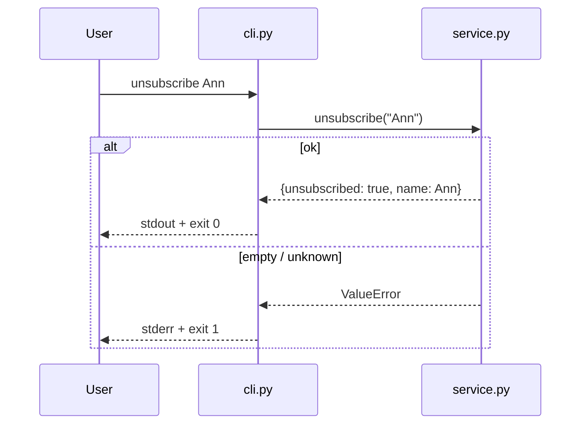

# Design

## Context

См. `proposal.md`. Сейчас есть только `subscribe` / `list_subscribers` и unittest-раннер. Persistence, веб-UI и внешние пакеты запрещены style guide.

## Goals / Non-Goals

**Goals:**
- Одна функция отписки в том же модуле, что и подписка
- Тонкий CLI без своего состояния — только argv → service → stdout/stderr
- Тесты покрывают happy path, empty, unknown и старое поведение A/B

**Non-Goals:**
- HTTP API, БД, конфиг-файл, цветной TUI
- Фильтр/поиск списка (можно отдельным change позже)
- Менять MCP `subscribe_name` в этом change

## Decisions

1. **Ошибки отписки через ValueError** — как у empty name в subscribe; CLI не парсит типы исключений сверх текста.
   - Альтернатива: `False` вместо исключения → отвергнуто, потому что пустой ввод уже exception-based.
2. **CLI на argparse вручную через sys.argv** — меньше магии, проще тестировать `main(argv)`.
   - Альтернатива: click/typer → внешняя зависимость, запрещена.
3. **Диаграмма взаимодействия в design** — правило проекта для design-артефактов.

## Risks / Trade-offs

- [Глобальный `subscribers` set] → Mitigation: тесты чистят set в `setUp`, CLI рассчитан на один процесс
- [Дублирование trim-логики] → Mitigation: один `.strip()` внутри `unsubscribe`, как в `subscribe`

## Migration Plan

Локальный учебный сервис: просто обновить файлы и прогнать `make test`. Откат — revert change.
