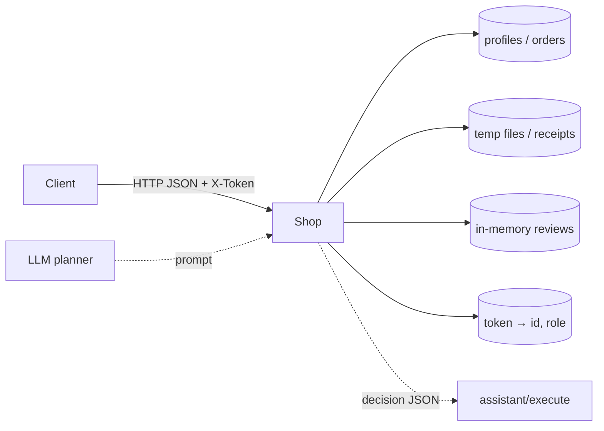

# Модель угроз — Mini Shop (практика 6)

Ориентир: описание системы → угрозы → меры → проверка (в духе Microsoft Threat Modeling).

## 1. Описание системы

Учебный HTTP-сервис на `127.0.0.1`: каталог, логин, профили, заказы, файлы-чеки в sandbox, отзывы, debug-логи, AI-помощник (`/assistant/context` + `/assistant/execute`).

Данные синтетические (`TEST_*`, `example.invalid`). Файловая граница — `sandbox.py` (не трогал).



### Trust boundaries

| Зона | Кто | Доверие |
|---|---|---|
| Клиент браузер/curl | любой на localhost | недоверенный |
| Сессия после login | alice / bob / staff | роль только с сервера |
| Sandbox FS | сервис | доверенный внутри temp root |
| LLM planner | внешняя модель | **недоверенный** вывод tool/arguments |

## 2. Активы

- ПДн учебного профиля (имя, email, адрес)
- Чеки клиентов и `private/operator-note.txt`
- Сессионные токены / пароли в логах
- Целостность заказов и цен каталога
- Возможность массового удаления fixture-файлов через tool

## 3. Угрозы (STRIDE-ish)

| ID | Категория | Где | Суть |
|---|---|---|---|
| T1 | Tampering / Injection | `/profile`, `/search`, context | SQL через склейку строк |
| T2 | Information disclosure | `/profile?id=`, `/orders`, `/files` | IDOR / чтение чужих данных без проверки владельца |
| T3 | Elevation of privilege | `/admin/export` | роль из заголовка `X-Role`, а не из сессии |
| T4 | Tampering | `POST /orders` | клиент задаёт `price` |
| T5 | Information disclosure | `/debug/logs` | токены и пароли без auth |
| T6 | Spoofing / XSS | `/reviews` → `/reviews/view` | HTML без экранирования |
| T7 | Elevation / Spoofing | `/assistant/execute` | execute без жёсткой ACL; tools `delete_tree`, `export_profiles` |
| T8 | Tampering (prompt) | context + отзывы | инструкции в отзыве/question влияют на planner |

## 4. Меры (что сделал)

- Параметризованный SQL
- AuthN на чувствительных маршрутах; AuthZ по `session.id` / `session.role` / `session.username`
- Игнор клиентского `price` и `X-Role`
- Файлы: только свой `receipt.txt` (для customer)
- Debug logs: staff + redact
- `html.escape` в ленте отзывов
- Assistant: свой заказ в context; execute разрешает только свой чек; `delete_tree` / `export_profiles` → 403
- Регрессии в `lab/test_security.py`

## 5. Проверка

```bash
cd practices/practice_06
make step6   # = make test
```
